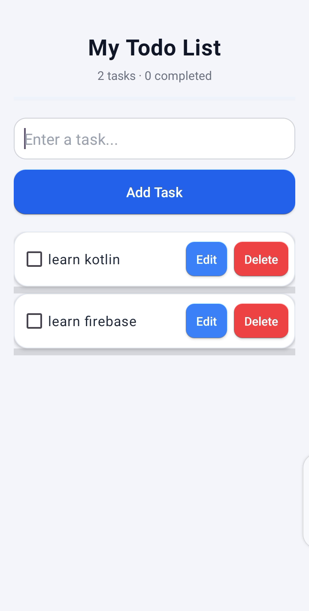
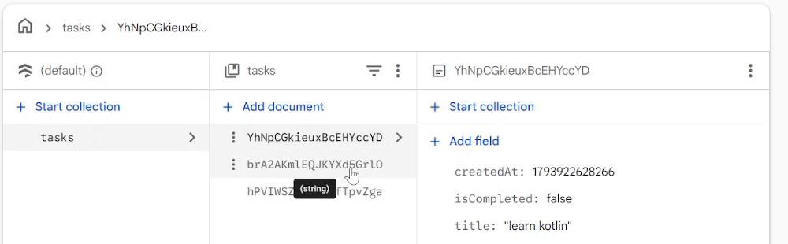

# 📝 To-Do List App: Android + Firebase Firestore

A clean Android To-Do List app built with **Kotlin** and **XML**. Tasks are stored in the cloud with **Firebase Firestore**, and the screen updates in **real time** whenever the data changes.

> 📺 **Video tutorial:**    [Watch the full video on YouTube](https://youtu.be/nw4Cz2YpSYQ)

## 📱 Screenshots

| App | Firestore database |
| --- | --- |
|  |  |

## ✨ Features

- Add, edit and delete tasks
- Mark tasks as completed (with strike-through)
- Task counter and progress bar
- Tasks saved in **Cloud Firestore**, so they are still there after you close the app
- **Real-time sync**: a change in the app or in the Firebase console shows up instantly (Firestore snapshot listener + Kotlin Flow)
- Friendly empty-state message

## 🛠️ Tech stack

- Kotlin, XML layouts, `ListView` with a custom adapter
- Firebase Firestore (Firebase BoM)
- Kotlin Coroutines and Flow (`callbackFlow`)
- Android Studio, Gradle version catalog

## 🧩 How it works

| File | What it does |
| --- | --- |
| `Task.kt` | Data class: `id` (`@DocumentId`), `title`, `isCompleted`, `createdAt` |
| `TaskRepository.kt` | Talks to the `tasks` collection: `insert`, `update`, `delete`, and `getAllTasks()` which returns a `Flow` fed by `addSnapshotListener` |
| `MainActivity.kt` | Collects the Flow, updates the list, counter and progress bar, handles Add and the edit dialog |
| `TaskAdapter.kt` | Draws each row, strike-through, Edit and Delete buttons |

Each task is a document in the `tasks` collection:

```
tasks / {documentId}
  ├─ title: "learn kotlin"
  ├─ isCompleted: false
  └─ createdAt: 1793922628266
```

## 🚀 Getting started

This repository does **not** include a Firebase config file, so you connect the app to your own free Firebase project:

1. Clone the repo and open it in **Android Studio**.
2. Go to the [Firebase console](https://console.firebase.google.com/) and create a project.
3. Add an **Android app** with the package name `com.choubapp.practice`.
4. Download `google-services.json` and put it in the **`app/`** folder.
   (`app/google-services.json.example` shows the expected format.)
5. In the console open **Firestore Database → Create database**.
6. Let Gradle sync, then run the app on an emulator or a real device.

### 🔒 Security note

For learning, you can start Firestore in test mode, but test mode is **open to everyone** and expires after 30 days. Before using this for anything real, add **Firebase Authentication** and write proper Firestore security rules so that users can only access their own tasks.

## 🗺️ Roadmap

- [ ] Replace `ListView` with `RecyclerView`
- [ ] Firebase Authentication (each user sees only their own tasks)
- [ ] Firestore security rules
- [ ] Show errors when a save fails

## 📚 Other versions

The earlier **Room database** version of this app lives here: [TodoListApp](https://github.com/bukhariwajid78-rgb/TodoListApp)

## 👨‍💻 Developer

**Syed Wajid Ali Bukhari**, Android developer
GitHub: [bukhariwajid78-rgb](https://github.com/bukhariwajid78-rgb)

If this project helped you, please give it a ⭐ and subscribe to the channel!
